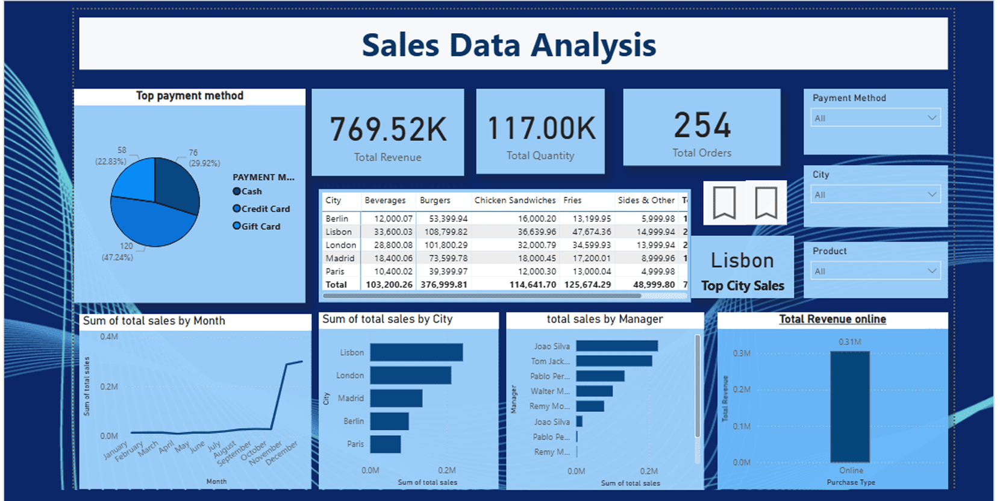
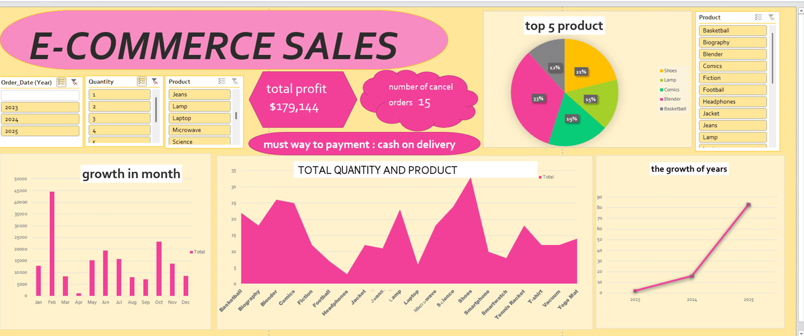
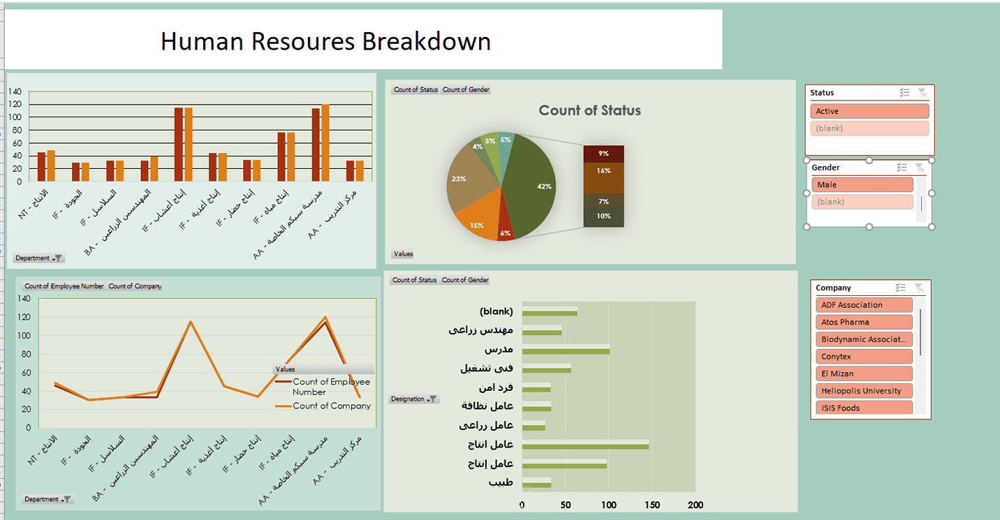

# Data Analytics & Business Intelligence Portfolio

**Power BI | SQL | DAX | Power Query | Data Modeling | Business Analytics**

This portfolio showcases data analytics and business intelligence projects focused on international trade, sales performance, inventory management, e-commerce, and human resources.

The projects demonstrate practical applications of data querying, analytical calculations, KPI reporting, data visualization, and interactive dashboard development to explore business questions and support data-informed decisions.

---

## 01. Dual Dependency Gap | Egypt’s Import Dependency & Trade Risk Analysis

### Project Overview

An international trade analytics project examining Egypt’s import dependency and potential exposure to external supply disruptions, with a focus on the Russia–Ukraine war and its implications for selected commodity groups.

### Business Objectives

- Examine import dependency across selected commodity groups.
- Compare import patterns before and after February 2022.
- Explore supplier concentration and potential exposure to external trade disruptions.
- Investigate historical trade values, prices, and market-share patterns where available.

### Analytical Approach

- Analyzed historical trade data covering 2019–2025.
- Examined selected food grains, fertilizers, iron and steel, and other commodities included in the project.
- Compared trade patterns before and after February 2022.
- Explored supplier concentration using the Herfindahl–Hirschman Index (HHI).
- Developed Power BI visualizations to explore trade patterns and potential vulnerabilities.

### Tools & Skills

Power BI · Power Query · DAX · Data Modeling · Trade Data Analysis · Concentration Analysis · Data Visualization

### Project Value

Demonstrates the application of business intelligence techniques to an economic question involving import dependency, supplier concentration, and potential trade risks.

---

## 02. Sales Data Analysis | Performance & KPI Reporting

### Project Overview

An interactive sales dashboard designed to monitor key performance indicators and explore sales patterns across locations, managers, payment methods, and time periods.

### Key Performance Indicators

| Metric | Reported Value |
|---|---:|
| Total Revenue | 769.52K |
| Total Quantity | 117.00K |
| Total Orders | 254 |

### Business Questions

- How does sales performance change over time?
- How do reported sales results vary across cities and managers?
- How are payment methods distributed?
- How is online revenue represented in the report?

### Analytical Approach

- Presented core metrics through KPI cards.
- Explored monthly sales trends.
- Compared sales across cities and managers.
- Examined payment method distribution and online revenue.
- Used interactive filters to support data exploration.

### Tools & Skills

Power BI · KPI Reporting · Sales Analysis · Trend Analysis · Data Visualization · Interactive Reporting

### Project Value

Demonstrates how interactive dashboards can consolidate business metrics and help users explore performance across multiple dimensions.

---

## 03. SQL Inventory Analysis | Stock Monitoring & Replenishment

**Project file:** [supply_chain_inventory.sql](./supply_chain_inventory.sql)

### Project Overview

A SQL-based inventory analysis project designed to examine stock availability, identify products below their defined reorder levels, and calculate inventory value across products and categories.

### Business Objectives

- Identify products with stock quantities below their reorder thresholds.
- Calculate total inventory value using available stock quantities and unit prices.
- Compare product counts across inventory categories.
- Rank products by stock quantity.
- Calculate and compare stock value at the individual product level.

### Analytical Approach

- Created and populated a structured inventory table.
- Retrieved inventory records for inspection.
- Applied conditional filtering to identify products below their reorder levels.
- Used aggregate calculations to estimate total inventory value.
- Grouped products by category to summarize the inventory mix.
- Calculated product-level stock values and sorted results for comparison.

### SQL Techniques

- `CREATE TABLE` and `INSERT INTO` for table creation and sample data loading.
- `SELECT` to retrieve inventory records.
- `WHERE` to filter products below reorder levels.
- `SUM()` to calculate total inventory value.
- `COUNT()` and `GROUP BY` to summarize products by category.
- `ORDER BY` to sort products by quantity and calculated stock value.
- Calculated expressions to derive stock value from quantity and unit price.

### Tools & Skills

SQL · Inventory Analysis · Stock Monitoring · Conditional Filtering · Aggregate Functions · Data Sorting · Replenishment Analysis

### Project Value

Demonstrates how SQL can be used to flag products below defined stock thresholds and summarize inventory value to support stock monitoring and replenishment decisions.

*Note: This project uses sample data and does not represent live inventory or actual business outcomes.*

---

## 04. E-Commerce Analytics | Sales, Profitability & Order Monitoring

### Project Overview

An e-commerce dashboard bringing together selected sales, profit, order-status, product-category, payment-method, and time-based metrics for interactive performance monitoring.

### Key Metrics

| Metric | Reported Value |
|---|---:|
| Total Profit | $179,144 |
| Cancelled Orders | 15 |

### Business Questions

- How are product categories represented in the report?
- How do sales-related metrics vary over time?
- How are payment methods distributed across the available data?
- How can profit and cancelled orders be monitored alongside other metrics?

### Analytical Approach

- Presented key metrics through KPI cards.
- Compared product categories through visualizations.
- Explored monthly and yearly patterns.
- Examined payment-method distribution.
- Used available filters to support focused analysis.

### Tools & Skills

Power BI · E-Commerce Reporting · KPI Monitoring · Product Analysis · Trend Visualization · Interactive Filtering

### Project Value

Demonstrates the use of interactive reporting to explore e-commerce metrics, product categories, payment methods, and order-related patterns.

---

## 05. HR Analytics | Workforce Distribution & Reporting

### Project Overview

A human resources dashboard designed to explore workforce distribution across departments, job designations, companies, gender, and employment status.

### Business Questions

- How is the workforce distributed across departments?
- How do employee counts vary across job designations and companies?
- How is the workforce distributed across gender and employment-status categories?
- How can interactive reporting make workforce information easier to explore?

### Analytical Approach

- Organized workforce information into visual summaries.
- Compared employee counts across available organizational categories.
- Examined employment-status and gender distribution.
- Used categorical charts to support comparisons.
- Incorporated interactive filters for focused exploration.

### Tools & Skills

Power BI · HR Reporting · Workforce Analysis · Categorical Analysis · Interactive Filtering · Data Visualization

### Project Value

Demonstrates how workforce data can be structured into an interactive reporting interface to support exploration and comparison of HR information.

---

## 06. Sales Analytics | Customer, Product & Business Performance

### Project Overview

An interactive sales dashboard designed to explore business performance across customer, product, order, and other dimensions represented in the report.

### Analytical Focus

- Review the sales and order-related metrics displayed in the dashboard.
- Explore customer and product performance through available visualizations.
- Compare results across geographic or categorical dimensions included in the report.
- Examine revenue- and profit-related measures where displayed.
- Use visual reporting to explore performance across business dimensions.

### Tools & Skills

Power BI · Sales Analytics · KPI Reporting · Data Exploration · Data Visualization

### Project Value

Demonstrates the use of dashboard-based reporting to consolidate sales information and enable structured exploration of business performance.

---

## 07. SQL Product Analysis | Aggregation & Category Insights

**Project file:** [sales_analysis.sql](./sales_analysis.sql)

### Project Overview

A SQL project focused on querying and analyzing product data to summarize catalog characteristics, compare product categories, and examine product prices.

### Analytical Objectives

- Retrieve and inspect product records.
- Calculate the total number of products.
- Calculate the average product price.
- Compare product counts and average prices across categories.
- Sort products by price to identify the highest-priced items.

### SQL Techniques

- `CREATE TABLE` and `INSERT INTO` to create and populate the sample dataset.
- `SELECT` to retrieve records and specific columns.
- `COUNT()` and `AVG()` for aggregate calculations.
- `GROUP BY` to summarize data by category.
- `ORDER BY` to sort products by price.

### Tools & Skills

SQL · Data Aggregation · Grouping · Sorting · Basic Data Analysis

### Project Value

Demonstrates foundational SQL skills for querying structured data, summarizing product information, and comparing prices across product categories.

*Note: This project analyzes sample product data rather than actual sales transactions.*

---

## Technical Skills

| Category | Skills |
|---|---|
| Business Intelligence | Power BI, Interactive Dashboards, KPI Reporting |
| Querying | SQL, SELECT, WHERE, JOINs, GROUP BY, Aggregate Functions |
| Data Transformation | Power Query, Data Cleaning, Data Preparation |
| Analytical Calculations | DAX Measures, KPI Calculations |
| Data Modeling | Data Relationships, Analytical Data Structures |
| Data Analysis | Trend Analysis, Category Comparisons, Performance Monitoring |
| Data Visualization | Dashboard Design, Visual Reporting, Interactive Filters |

---

## Analytical Workflow

**1. Business Understanding**  
Define the analytical question, business context, and reporting requirements.

**2. Data Preparation**  
Inspect, clean, transform, and organize available data for analysis.

**3. Data Modeling & Calculations**  
Structure data for reporting and develop relevant analytical measures where required.

**4. Analysis & Visualization**  
Explore trends, compare categories, and present metrics through clear visualizations.

**5. Reporting & Communication**  
Organize information into accessible reports that support further investigation and informed discussion.
----
---

Thank you for visiting my portfolio.
